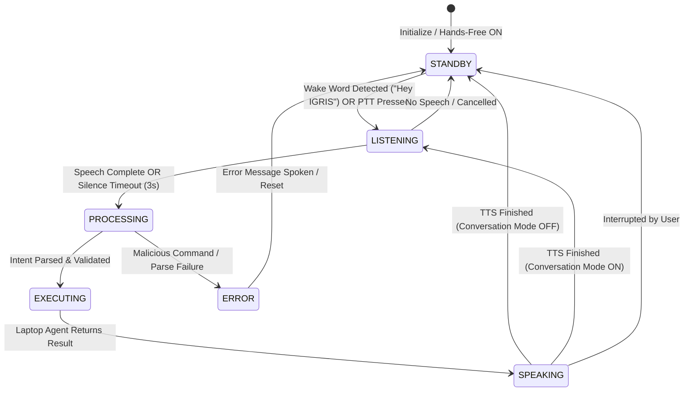

# JARVIS / IGRIS Phase 12: Hands-Free Voice, Wake Word & Context

## 1. Overview & Architectural Scope
Phase 12 transforms IGRIS from a push-to-talk assistant into a modern, hands-free Alexa/Siri-style ambient voice assistant while maintaining absolute zero-compromise security invariants.

```
       📱 Client Phone / Web Browser (Local On-Device Engine)
         - Local Wake-Word Detector ('IGRIS', 'Hey IGRIS', 'Okay IGRIS')
         - Voice State Machine (STANDBY ⇄ LISTENING ⇄ PROCESSING ⇄ EXECUTING ⇄ SPEAKING)
         - Visual Privacy Badges (MIC_OFF, MIC_STANDBY, MIC_LISTENING, MIC_PROCESSING)
         - Speech-to-Text via Web Speech API (Local Audio Processing)
         - Text-to-Speech via IGRIS Voice Personality Engine (Phase 9.5)
         - Interruption Handler & Duplicate Audio Suppression
                          ↕ JSON over WebSocket / HTTPS (ZERO RAW AUDIO TRANSMISSION)
    ╭────────────────────────────────────────────────────────╮
    │                 Node.js Gateway Server                 │
    │  ┌──────────────────────┐   ┌───────────────────────┐  │
    │  │ Language Engine      │   │ Independent Validator │  │
    │  │ (en / hinglish / hi) │   │ (Allowlist & Sandbox) │  │
    │  └──────────────────────┘   └───────────────────────┘  │
    │  ┌──────────────────────┐   ┌───────────────────────┐  │
    │  │ Gemini 2.5 Flash /   │   │ Multi-Step Workflow   │  │
    │  │ Semantic Interpreter │   │ Engine (Phase 8 & 9)  │  │
    │  └──────────────────────┘   └───────────────────────┘  │
    ╰────────────────────────────────────────────────────────╯
                          ↕ Socket.IO (Authenticated)
               🐍 Python Laptop Agent (LAPTOP-01)
         - Safe Command Registry (Phases 1-11)
         - Hardware Telemetry & System Monitoring
         - Window & Media Controllers
         - Workspace Sandbox Guard (D:\JARVIS\workspace)
         - Audit Logging & Verification
```

---

## 2. Core Security & Privacy Invariants

1. **Local On-Device Processing (Zero Audio Streaming)**:
   - Microphone audio is processed entirely on the client device (browser Web Speech API).
   - No continuous raw audio stream, recording buffers, or voice telemetry are transmitted to the Node.js server or cloud endpoints. Only finalized, recognized text strings are sent.
   - Preserves user privacy and network bandwidth.

2. **No Validator Bypasses**:
   - Voice inputs carry **zero elevated privileges**.
   - Spoken commands pass through the identical validation pipeline as typed commands:
     - Independent Schema Validator
     - Safe Action Allowlist
     - Workspace Sandbox Guard
     - Sensitive Credential Shield
   - Natural spoken attempts to bypass safety (e.g., prompt injections, jailbreaks, shell commands, path traversal) are rejected at the validator.

3. **Explicit Wake-Word Authentication Separation**:
   - The wake word ("IGRIS") serves only as a local interface trigger.
   - It does **not** grant or bypass Socket.IO authentication tokens (`JARVIS_AUTH_TOKEN`, `IGRIS_PHONE_TOKEN`).
   - Unauthorized clients cannot trigger execution even if the wake word is spoken.

4. **Visual Microphone Privacy Indicators**:
   - `MIC_OFF`: Microphone permission not granted or hands-free disabled.
   - `MIC_STANDBY`: Passive background listening for the wake word only.
   - `MIC_LISTENING`: Active listening window for the user's command.
   - `MIC_PROCESSING`: Audio paused; command being parsed and validated.

5. **Bounded Execution & Timeout Limits**:
   - `COMMAND_TIMEOUT_MS = 8000`: Maximum duration allowed for speaking a command.
   - `SILENCE_TIMEOUT_MS = 3000`: Hands-free listener returns to standby if silence is detected.
   - `CONVERSATION_TIMEOUT_MS = 6000`: Follow-up dialogue window for multi-turn requests.

---

## 3. Voice State Machine



- **Standby**: Low-power listening for wake-word patterns (`'igris'`, `'hey igris'`, `'okay igris'`, `'hello igris'`, `'ok igris'`, `'hi igris'`).
- **Listening**: Captures command audio. In single-breath commands ("IGRIS, open Notepad"), the remainder is extracted immediately without re-prompting.
- **Processing**: Transitions to the server for multilingual Gemini interpretation and independent command validation.
- **Executing**: Dispatched over Socket.IO to `LAPTOP-01` agent.
- **Speaking**: Reads response using the Phase 9.5 male commander voice personality. Supports user barge-in / interruption via `interruptSpeaking()`.

---

## 4. Multilingual Spoken Command Support

The voice engine seamlessly handles commands in English, Hinglish, and Hindi:

| Spoken Input | Target Action | Description |
| :--- | :--- | :--- |
| `"IGRIS, open Chrome."` | `open_app(chrome)` | English application launch |
| `"IGRIS, Chrome kholo."` | `open_app(chrome)` | Hinglish application launch |
| `"IGRIS, क्रोम खोलो।"` | `open_app(chrome)` | Hindi application launch |
| `"IGRIS, mera CPU usage batao."` | `system_status()` | Hinglish system telemetry query |
| `"IGRIS, पायथन फ़ाइलें खोजो।"` | `search_files(.py)` | Hindi workspace search |
| `"Now search Python tutorials"` | `search_web(...)` | Conversation follow-up (no wake word required) |
| `"IGRIS, minimize Chrome."` | `minimize_window(chrome)` | Window control command |
| `"how is my laptop performing?"` | `system_status()` | Natural conversational status query |
| `"what song is playing?"` | `media_status()` | Active media player query |

---

## 5. Components Created & Modified

### New Frontend Services & Components:
- `phone-ui/src/types/voice.ts`: Voice states, privacy states, settings, and wake-word callback definitions.
- `phone-ui/src/services/wakeWordService.ts`: Local on-device Web Speech API wake-word detector with prefix extraction and variation matching.
- `phone-ui/src/services/voiceStateService.ts`: Central state machine orchestrating wake words, audio timeouts, duplicate prevention, and command dispatch.
- `phone-ui/src/components/VoiceAssistant.tsx`: Full-featured voice card with live audio visualization, PTT button, hands-free toggle, conversation mode toggle, and privacy indicator.
- `phone-ui/src/components/VoiceStatus.tsx`: Compact pill displaying active state (`STANDBY`, `LISTENING`, etc.) and microphone privacy state.

### Modified Server & UI Files:
- `server/ai/gemini.js`: Enhanced natural language patterns for telemetry queries ("how is my laptop performing") and window management ("show my Chrome window").
- `phone-ui/src/services/textToSpeech.ts`: Added `onEnd` completion callback to coordinate conversation follow-ups.
- `phone-ui/src/services/voicePersonality.ts`: Added default Phase 12 configuration options and persistence.
- `phone-ui/src/components/VoiceSettings.tsx`: Added toggles for Hands-Free mode and Conversation Follow-Up mode.
- `phone-ui/src/components/mobile/HomeScreen.tsx` & `MobileApp.tsx`: Integrated VoiceAssistant on home screen and VoiceStatus in the top bar.
- `phone-ui/src/App.tsx`: Connected voiceStateService command dispatcher to `handleSendAiCommand`.

---

## 6. Verification & Regression Results

### Phase 12 Dedicated Suite (`test-phase12.py`)
- **Total Tests**: 40
- **Passed**: 40/40 (100.0%)
- **Test Groups**:
  - Group 1: Wake Word Detection & Parsing (5/5)
  - Group 2: Voice State Machine & Timeouts (5/5)
  - Group 3: Speech Errors, Privacy & Interruption (6/6)
  - Group 4: Multilingual Voice Command Interpretation (9/9)
  - Group 5: Security Invariants & Injection Defense (7/7)
  - Group 6: Voice Telemetry, Window & Media Integration (4/4)
  - Group 7: Live Phone Socket.IO Voice E2E (4/4)

### Complete System Regression Suite (`run-all-tests.py`)
- Full test pass across Phases 2 through 12: 100% SUCCESS.
