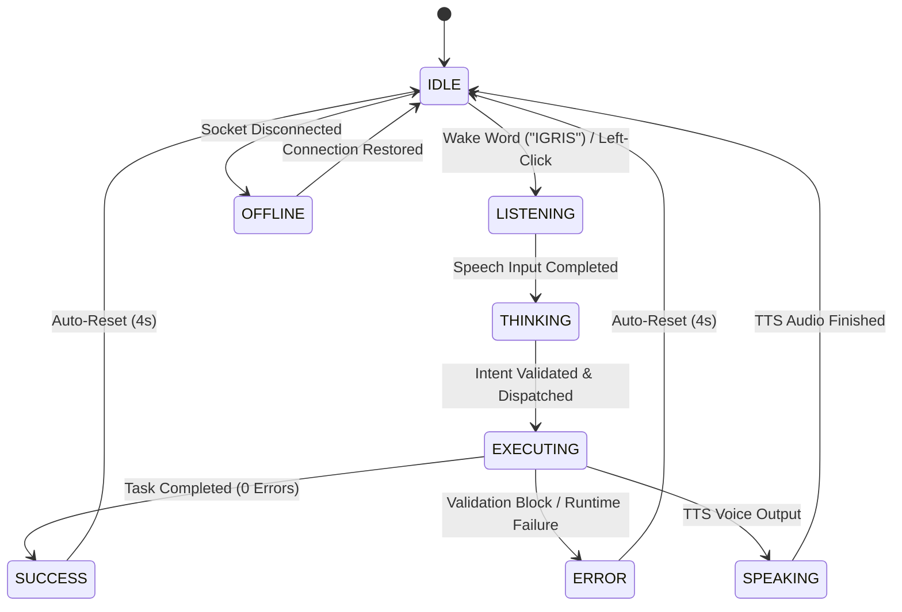

# JARVIS / IGRIS Phase 13: 2.5D Local Windows Desktop AI Companion

## 1. Overview & Architectural Scope
Phase 13 introduces a lightweight **2.5D Local Windows Desktop AI Companion** for IGRIS. Floating directly on the Windows desktop, IGRIS serves as an interactive visual companion that synchronizes in real time with the existing IGRIS Node.js server, laptop agent, Phase 9.5 voice personality, and Phase 12 hands-free wake-word engine.

```
                    CLOUD / LOCAL SERVER
                    ┌───────────────────┐
                    │   IGRIS Server    │
                    │ (Render / Node.js)│
                    └─────────┬─────────┘
                              │
                        Socket.IO
                              │
                    ┌─────────▼─────────┐
                    │   Windows Laptop  │
                    │                   │
                    │    2.5D IGRIS     │
                    │     Companion     │
                    │  (Electron/Local) │
                    │         │         │
                    │         ▼         │
                    │    Laptop Agent   │
                    │    (LAPTOP-01)    │
                    └───────────────────┘
```

---

## 2. Technology Stack & Design Decisions
- **Runtime**: **Electron** (v33.2.1) + Node.js (v25.2.1). Chosen over heavier 3D engines because it natively supports:
  - Transparent, frameless always-on-top desktop windows.
  - Hardware-accelerated 2D/2.5D Canvas & SVG rendering.
  - Windows System Tray integration with native context menus.
  - Secure context isolation (`contextBridge`) and sandboxing.
- **2.5D Effect**: Multi-layered SVG cutouts with independent depth offsets (Z-translation, mouse parallax perspective tilt, floating sine-wave levitation, and dynamic particle emission).
- **Asset Abstraction**: Fully modular architecture (`assets/igris/manifest.json`) enabling drop-in character artwork replacement without rewriting application logic.

---

## 3. Core Security & Privacy Invariants

1. **Zero Security Bypass**:
   - The desktop companion has **no direct shell or execution privileges**.
   - Spoken or clicked commands are dispatched over Socket.IO to the existing server pipeline:
     `User Query` ➔ `Gemini Interpreter` ➔ `Independent Validator` ➔ `Safe Command Registry` ➔ `Laptop Agent` ➔ `Windows`.
   - Never invokes raw CMD, PowerShell, arbitrary binaries, or unapproved filesystem operations.

2. **Zero Secret Exposure**:
   - Authentication tokens (`JARVIS_PHONE_TOKEN`, `IGRIS_PHONE_TOKEN`) are loaded securely in the Node.js main process from the environment or `.env`.
   - No authentication tokens or sensitive keys are exposed to renderer scripts or HTML assets.
   - Renderer operates with `nodeIntegration: false` and `contextIsolation: true`.

3. **Existing System Compatibility**:
   - Zero modifications to laptop agent (`LAPTOP-01`) or phone UI architecture.
   - Both interfaces coexist simultaneously on the Socket.IO broadcast channels.

---

## 4. Window Architecture & Desktop Behavior

- **Frameless & Transparent**:
  - `transparent: true`, `frame: false`, `hasShadow: false`.
  - The companion window displays only the character and speech bubble; surrounding areas are completely transparent.
- **Default Position & Safe Margins**:
  - Positioned by default in the **bottom-right corner** above the Windows taskbar (`marginRight: 25px`, `marginBottom: 35px`).
- **Multi-Monitor Safety & Persistence**:
  - Window coordinates and size are saved to `userData/igris-companion-settings.json`.
  - On launch or display metrics changes, `validateBounds()` ensures the window is visible on an active monitor; if invalid, it gracefully resets to safe default bounds.
- **Size Presets**:
  - **Small**: 160 x 260 px
  - **Medium** (Default): 240 x 380 px
  - **Large**: 320 x 500 px
- **Movement & Interaction**:
  - Left click: Arms voice listening or triggers status report.
  - Double click: Performs instant system status query via AI.
  - Dragging: `-webkit-app-region: drag` enables effortless repositioning anywhere on the desktop.
  - Right click: Context menu (*Open IGRIS*, *Voice Command*, *Settings*, *Always on Top*, *Minimize*, *Exit*).

---

## 5. The 8 Synchronized Visual States



| State | Visual Behavior | Energy & Aura FX | Audio Synchronization |
| :--- | :--- | :--- | :--- |
| **IDLE** | Calm floating levitation (4.5s loop). | Subtle breathing glow in armor seams; gentle red particles. | Standby for wake word `"IGRIS"`. |
| **LISTENING** | Alert raised head posture. | Eyes brighten by 220%; pulsing halo aura. | Web Speech API actively capturing command. |
| **THINKING** | Tilted helm posture. | Rotating orbit glyphs and data rings. | AI Gemini intent parsing. |
| **EXECUTING** | Commanding battle stance. | Surging crimson plasma arcs; task step progress displayed. | Laptop agent running approved command. |
| **SPEAKING** | Subtle rhythmic head tilt. | Waveform energy pulse synchronized with audio. | Phase 9.5 male commander TTS playback. |
| **SUCCESS** | Confident upright stance. | Radiant crimson bloom pulse from chest reactor. | Confirms completed workflow. |
| **ERROR** | Braced defensive posture. | Warning glitch red aura; safe alert text. | Blocks disallowed operations safely. |
| **OFFLINE** | Dormant posture. | Armor dimmed to 40% brightness; zero particles. | Displays reconnection status. |

---

## 6. Voice & Wake Word Integration

- **Phase 12 Wake Word**: Supports on-device Web Speech API wake-word detection:
  - Variations: `"IGRIS"`, `"Hey IGRIS"`, `"Okay IGRIS"`, `"Hello IGRIS"`, `"OK IGRIS"`, `"Hi IGRIS"`.
  - Immediate single-breath command extraction (e.g. *"IGRIS, open Chrome"* ➔ extracts *"open Chrome"*).
  - Zero raw audio streamed across the network.
- **Phase 9.5 TTS Synthesis**:
  - Deep male commander resonance (`pitch: 0.85`, `rate: 0.95`).
  - Native browser speech synthesis targeting preferred male voices.

---

## 7. System Tray & Auto-Start Configuration

- **Windows System Tray**:
  - Custom dark crimson IGRIS knight crest icon located in the Windows notification area.
  - Native Tray menu:
    - *Open IGRIS Companion*
    - *Voice Command*
    - *Settings*
    - *Restart Connection*
    - *Exit*
  - Closing the companion window minimizes it to the tray without interrupting background Socket.IO monitoring.
- **Start with Windows**:
  - Toggleable via Companion Settings modal (`app.setLoginItemSettings({ openAtLogin: true })`). Default is `OFF`.

---

## 8. File Structure

```
D:\JARVIS\desktop-companion\
├── package.json               # Electron project configuration & dependencies
├── main.js                    # Electron main process (transparent window, tray, IPC)
├── preload.js                 # Secure contextBridge interface
├── index.html                 # Frameless companion window markup
├── styles.css                 # 2.5D layer styles, floating animations, and state FX
├── renderer.js                # Character controller, state machine, particle engine, parallax
├── voice.js                   # Phase 12 wake-word & Phase 9.5 TTS audio engine
├── socket-client.js           # Authenticated Socket.IO client
├── settings-store.js          # Persistent JSON store for bounds, size, and settings
└── assets\
    └── igris\
        ├── manifest.json      # Replaceable character manifest & state definitions
        ├── icon.png           # 64x64 desktop and tray icon
        ├── layers\            # Modular SVG cutouts
        └── images\            # Master turnaround and state reference sheets
```

---

## 9. Local Run & Build Instructions

### Running the Companion in Development
```powershell
cd D:\JARVIS\desktop-companion
npm start
```

### Packaging into a Windows Executable (.exe)
```powershell
cd D:\JARVIS\desktop-companion
npx electron-builder --win
```
Output will be generated in `D:\JARVIS\desktop-companion\dist\`.

---

## 10. Verification & Test Results

- **Phase 13 Dedicated Test Suite (`test-phase13.py`)**:
  - **Results**: **30/30 PASSED (100.0%)**
- **Full Regression Test Suite (`run-all-tests.py`)**:
  - **Results**: **Phases 2 through 13 PASSED with 100% SUCCESS**.
