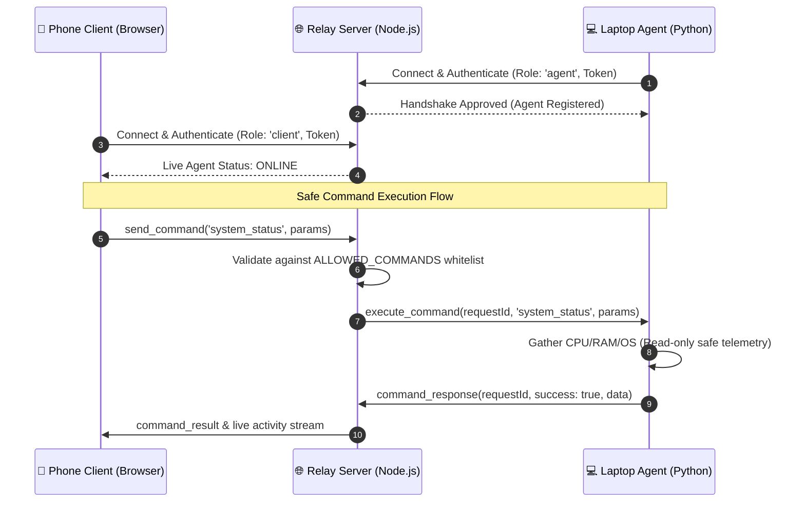

# 🤖 J.A.R.V.I.S. (Phase 1)
### Personal Phone-to-Laptop Control System

> **Phase 1 Goal**: Establish a rock-solid, bidirectional, authenticated communication pipeline connecting a Python Windows Laptop Agent to a Node.js Socket.IO server, ready to receive safe commands from a mobile phone interface.

---

## 📋 Architecture Overview

The system consists of three decoupled components communicating over real-time WebSockets (Socket.IO):

```
┌─────────────────────────────────┐
│        📱 PHONE / CLIENT        │
│   (Mobile Web UI / REST / App)  │
└────────────────┬────────────────┘
                 │  Socket.IO / HTTP (Port 3000)
                 │  Bearer Auth Token: JARVIS_AUTH_TOKEN
                 ▼
┌─────────────────────────────────┐
│       🌐 NODE.JS RELAY SERVER   │
│   (Express + Socket.IO Server)  │
│    - Authenticates connections  │
│    - Whitelists safe commands   │
│    - Tracks Agent Online status │
│    - Serves Mobile Web UI       │
└────────────────┬────────────────┘
                 │  Socket.IO Room Dispatch
                 │  Event: 'execute_command' / 'command_response'
                 ▼
┌─────────────────────────────────┐
│     💻 PYTHON LAPTOP AGENT      │
│      (Windows Background Agent) │
│    - Auto-reconnect resilience  │
│    - Sandboxed command engine   │
│    - Strict app whitelisting    │
│    - Safe Workspace isolation   │
└─────────────────────────────────┘
```



---

## 📂 Project Structure

```
JARVIS/
├── server/
│   ├── server.js            # Express + Socket.IO relay server & auth gatekeeper
│   ├── package.json         # Node.js dependencies (express, socket.io, dotenv, cors)
│   ├── .env.example         # Server environment variables template
│   └── .env                 # Active server environment configuration
├── laptop-agent/
│   ├── agent.py             # Resilient Socket.IO client & event listener
│   ├── commands.py          # Sandboxed safe commands execution engine
│   ├── config.py            # Environment settings and safe workspace resolver
│   ├── requirements.txt     # Python dependencies (python-socketio, psutil, dotenv)
│   ├── .env.example         # Agent environment variables template
│   └── .env                 # Active agent environment configuration
├── phone-ui/
│   ├── index.html           # Responsive JARVIS HUD mobile web interface
│   ├── style.css            # Dark hologram theme & mobile layout
│   └── app.js               # Real-time client controller & live telemetry
├── workspace/               # Predefined safe root directory for created folders
├── start-server.bat         # 1-Click Windows launcher for the Server
├── start-agent.bat          # 1-Click Windows launcher for the Laptop Agent
├── test-client.py           # Automated test suite verifying auth and all commands
└── README.md                # System documentation and setup guide
```

---

## 🛡️ Security Model & Strict Boundaries

To ensure safe remote control, Phase 1 enforces strict defense-in-depth:

1. **NO Arbitrary Shell Execution**:
   - The agent strictly rejects any shell command execution.
   - Applications are launched using `subprocess.Popen([executable], shell=False)` with NO shell interpreter (`cmd.exe` or `powershell.exe`) and NO user-supplied CLI flags.
2. **NO Arbitrary File Deletion or Modification**:
   - File modification and deletion APIs are **completely omitted** from the codebase.
   - Only folder creation is supported, and it is strictly constrained to the safe directory.
3. **Safe Workspace Sandboxing (`create_folder`)**:
   - Target root: `JARVIS/workspace/`.
   - Directory traversal (`..`), absolute paths, and Windows drive roots (`C:\`) are explicitly rejected.
   - Illegal Windows filename characters (`< > : " / \ | ? *`) and reserved device names (`CON`, `PRN`, `AUX`, `NUL`, `COM1-9`, `LPT1-9`) are blocked.
4. **Strict URL Scheme Validation (`open_url`)**:
   - Only `http://` and `https://` URLs are accepted.
   - Dangerous schemes such as `file://`, `javascript:`, `cmd:`, `powershell:`, and `ms-settings:` are rejected.
   - URLs are opened via Windows standard browser registration (`webbrowser.open`).
5. **App Whitelisting (`open_app`)**:
   - Only explicitly approved applications in `WHITELISTED_APPS` can be launched:
     - `notepad` -> Windows Notepad (`notepad.exe`)
     - `calculator` -> Windows Calculator (`calc.exe`)
     - `paint` -> MS Paint (`mspaint.exe`)
     - `explorer` -> Windows Explorer (restricted to open only the JARVIS workspace)
6. **Token Authentication**:
   - Shared secret (`JARVIS_AUTH_TOKEN`) required during the Socket.IO connection handshake and REST API headers (`Authorization: Bearer <token>`).
   - Unauthenticated or invalid token requests are immediately rejected.

---

## ⚙️ Prerequisites for Windows

- **Node.js**: v18.0 or newer (tested with v25.2.1)
- **Python**: 3.9 or newer (tested with Python 3.14 on Windows)
- **Wi-Fi / Local Network**: Laptop and phone connected to the same Wi-Fi network (or localhost for local testing).

---

## 🚀 Setup & Installation Instructions

### 1. Configure the Server

1. Open PowerShell or Command Prompt and navigate to the `server` directory:
   ```powershell
   cd d:\JARVIS\server
   ```
2. Install dependencies:
   ```powershell
   npm install
   ```
### 1. Configure the Server

1. Open PowerShell or Command Prompt and navigate to the `server` directory:
   ```powershell
   cd d:\JARVIS\server
   ```
2. Install dependencies:
   ```powershell
   npm install
   ```
3. Set your server environment variables in `server/.env`:
   ```ini
   JARVIS_AUTH_TOKEN=your-strong-random-token
   PORT=3000
   ```

### 2. Configure the Laptop Agent

1. Navigate to the `laptop-agent` directory:
   ```powershell
   cd d:\JARVIS\laptop-agent
   ```
2. Install Python dependencies:
   ```powershell
   python -m pip install -r requirements.txt
   ```
   *(If `python` is not in your current shell PATH, use the full path to your Python executable, e.g., `& "$env:LOCALAPPDATA\Python\pythoncore-3.14-64\python.exe" -m pip install -r requirements.txt`)*

3. Set your agent environment variables in `laptop-agent/.env`:
   ```ini
   JARVIS_SERVER_URL=http://localhost:3000
   JARVIS_AUTH_TOKEN=your-strong-random-token
   JARVIS_AGENT_ID=LAPTOP-01
   JARVIS_WORKSPACE_DIR=d:\JARVIS\workspace
   ```

---

## 🏃 Running the System

### Option A: Using 1-Click Windows Batch Launchers

1. Double-click **`start-server.bat`** (launches the Node.js relay server in its own terminal).
2. Double-click **`start-agent.bat`** (launches the Python laptop agent in its own terminal).

### Option B: Using the Command Line

**Terminal 1 (Relay Server):**
```powershell
cd d:\JARVIS\server
node server.js
```
*Expected Server Output:*
```
JARVIS Server
------------------------------
Server running on port 3000
Health endpoint: /health
Laptop agent connected
Agent ID: LAPTOP-01
Authentication: SUCCESS
```

**Terminal 2 (Laptop Agent):**
```powershell
cd d:\JARVIS\laptop-agent
python agent.py
```
*Expected Laptop Output:*
```
JARVIS Laptop Agent
------------------------------
Agent ID: LAPTOP-01
Connecting to JARVIS Server...
Authentication successful
Connected to JARVIS Server
Status: ONLINE
Waiting for commands...
```

*Automatic Reconnection (when server stops and restarts):*
```
Server unavailable
Reconnecting...
Reconnected successfully
Status: ONLINE
```

---

## 📱 Connecting From Your Phone

1. **Find your Laptop's Local IP Address**:
   In PowerShell, run:
   ```powershell
   ipconfig
   ```
   Look for `IPv4 Address` under your active Wi-Fi adapter (for example, `192.168.1.45`).

2. **Open the Phone Interface**:
   On your phone's browser (Safari, Chrome, etc.), navigate to:
   ```
   http://192.168.1.45:3000
   ```
   *(Ensure both devices are on the same Wi-Fi network and port 3000 is allowed by Windows Firewall if prompted)*.

3. **Interact with JARVIS**:
   - The status badge in the header will turn green: `Laptop: Online`.
   - **System Telemetry**: Tap "Get System Status" to view real-time CPU load, RAM usage, OS version, and battery status.
   - **Open URL**: Tap "YouTube" or enter a URL and tap "Open" to launch it on your laptop.
   - **Create Folder**: Enter a folder name and tap "Create" to create a sandboxed folder in `workspace/`.
   - **Launch Apps**: Tap Notepad, Calculator, or Paint to launch them safely on your Windows laptop.

---

## 🧪 Automated Testing & Verification

Run the comprehensive end-to-end test suite to verify all commands, authentication, and security protections:

```powershell
cd d:\JARVIS
python test-client.py
```

The test suite runs 11 automated verification checks:
- ✅ Reject connections with invalid auth tokens
- ✅ Accept connections with valid auth tokens
- ✅ Verify Laptop Agent connection status
- ✅ Execute `system_status` (returns CPU, RAM, and OS telemetry)
- ✅ Execute `create_folder` (creates folder in `workspace/`)
- ✅ Block path traversal attacks in `create_folder` (`../../ExploitFolder`)
- ✅ Execute `open_url` for valid HTTP/HTTPS URLs
- ✅ Block invalid URL schemes in `open_url` (`file:///...`)
- ✅ Execute `open_app` for whitelisted apps (`calculator`)
- ✅ Block non-whitelisted applications in `open_app` (`cmd.exe`)
- ✅ Block arbitrary shell commands (`shell_exec`)
- ✅ Execute commands via authenticated REST API (`POST /api/command`)

---

## 🔮 Phase 2 Extensibility & Modular Roadmap

The architecture was intentionally designed for seamless modular expansion in future phases:

- **AI Brain Integration**:
  - The `commands.py` module exposes `execute_safe_command(command, params)` as pure Python functions.
  - An LLM (Gemini / Claude / OpenAI) can be integrated as a planner agent that converts natural language user requests ("Open a note about my meeting") into structured safe command calls (`open_app(app_name="notepad")`).
- **Voice Recognition**:
  - Voice input from the phone (Web Speech API or Whisper) can stream audio or transcribed text to the server.
- **Native Phone App**:
  - The Socket.IO protocol and `/api/command` REST endpoint are fully compatible with Flutter, React Native, or iOS Shortcuts/Tasker widgets.
