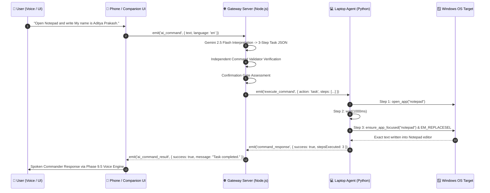

# ⚔️ IGRIS (formerly J.A.R.V.I.S.)
### Autonomous Phone-to-Laptop AI Assistant & 2.5D Desktop Companion

> **Current Status**: **Phases 1 through 14 Completed & Fully Verified**  
> **Test Coverage**: **330+ Automated Tests Passing with 100% Success (Zero Regressions)**

---

## 🌌 System Overview

**IGRIS** is a production-grade personal AI assistant and desktop companion system that connects your smartphone, a cloud relay server, and your Windows laptop into a unified, secure, real-time command-and-control mesh.

Designed with an original **Shadow Commander / Dark Armored Knight** aesthetic, IGRIS combines multilingual voice interaction (English, Hinglish, Hindi), Gemini 2.5 Flash intelligence, Win32 window and workspace automation, ambient hands-free wake-word detection, and a lightweight 2.5D floating desktop companion.

---

## 🏛️ Architecture Overview

The system operates across four primary decoupled layers communicating via authenticated WebSockets (Socket.IO):

```
                       📱 PHONE UI / MOBILE WEB
              (React + Vite PWA / English, Hinglish, Hindi)
               - Push-to-Talk & Hands-Free Ambient Wake Word
               - Real-Time Hardware & Media Dashboard
               - Interactive Task Confirmation & File Explorer
                                   │
                                   │ HTTPS / WSS
                                   ▼
                       🌐 IGRIS GATEWAY SERVER
                  (Node.js / Express / Render Cloud)
               - Dual Token Authentication (Client & Agent)
               - Google Gemini 2.5 Flash Command Interpretation
               - Independent Server-Side Command Validator
               - Multi-Turn Session Memory & Trilingual Engine
               - Safe Task Confirmation Gate (≥3 Steps)
                                   │
                                   │ Socket.IO (Encrypted & Authenticated)
                                   ▼
    ┌──────────────────────────────┴──────────────────────────────┐
    │                                                             │
    ▼                                                             ▼
💻 PYTHON LAPTOP AGENT                            🗡️ 2.5D DESKTOP COMPANION
(Windows Background Service)                      (Electron Frameless Window)
- Safe Command Registry (47+ actions)             - Multi-Layer Parallax Rig
- Hardware Telemetry (CPU, RAM, Battery, Disk)    - 8 Real-Time Animation States
- Win32 Window Manager (Focus, Min, Max)          - Transparent Canvas & Particles
- Spotify & Multimedia Keyboard Controller        - Local Voice Synthesis & Audio
- Master Volume & Screen Brightness Engine        - Native Socket.IO Synchronization
- Smart Notepad & Text Automation (5-Step)        
- Workspace Assistant (AST & PDF)                 
- Safe Text Injection (Win32 EM_REPLACESEL)
```



---

## 🗺️ Comprehensive Phase Breakdown

### Phase 1 — Security & Safe Command Engine
- **Core Architecture**: Bidirectional authenticated Socket.IO communication between Python laptop agent and Node.js server.
- **Strict Whitelist Barrier**: Absolute rejection of arbitrary shell, PowerShell, or command-line scripts (`shell=False` execution only).
- **Workspace Containment**: Path traversal (`..`), absolute drive paths (`C:\`), illegal filename characters, and Windows reserved device names (`CON`, `PRN`, `AUX`, `NUL`) strictly blocked.
- **Initial Safe Actions**: `system_status`, `create_folder`, `open_url`, `open_app`.

### Phase 2 — Phone ↔ Server ↔ Laptop Communication
- **Cloud & Local Deployment**: Production-ready deployment architecture (Render Node.js Gateway + Vercel PWA / Localhost).
- **Resilient Sockets**: Automatic reconnection handling, heartbeat monitoring, and authenticated role-based room isolation (`agent` vs `client`).
- **Mobile HUD Web Client**: Responsive, dark futuristic mobile control center with live activity feed and latency badges.

### Phase 3 — Gemini AI Command Interpretation
- **LLM Engine**: Integration with Google Gemini 2.5 Flash via official `@google/genai` SDK.
- **Independent Validator**: Secondary server-side security gatekeeper (`server/ai/command-validator.js`) that re-validates LLM JSON output against strict parameter schemas before transmission.
- **Defense-in-Depth**: Automatic detection and neutralization of prompt injections, role-play bypasses, and unauthorized system access attempts.
- **Deterministic Semantic Fallback**: Offline rule-based interpreter ensuring zero downtime when cloud AI APIs are unavailable.

### Phase 4 — Voice Input & Speech Synthesis (TTS)
- **Speech-to-Text (STT)**: Real-time browser speech recognition with continuous listening and live transcript rendering.
- **Text-to-Speech (TTS)**: Natural voice synthesis providing real-time spoken confirmations, telemetry readings, and error alerts.
- **Audio Feedback Controls**: Push-to-talk button, live waveform visualizer, and instant speech toggle controls.

### Phase 5 — Multi-Turn Conversation Memory
- **Sliding-Window Session Store**: In-memory context cache tracking the last 6 turns (bounded to 1500 characters) per session.
- **Contextual Continuity**: Resolves conversational pronouns and follow-up directives (*"What is my CPU usage?"* ➔ *"Is it dangerous?"* or *"Open Chrome"* ➔ *"Now search Python tutorials"*).
- **Poisoning Defense**: Scans prior conversation history to block multi-turn prompt injection attempts.

### Phase 6 — Laptop Control Center & Safe App Sandboxing
- **Expanded Application Whitelist**: Safe launching of `notepad`, `calculator`, `paint`, `code`, `chrome`, and `explorer`.
- **Workspace Navigation**: Safe directory exploration (`open_folder`, `list_folder`, `get_file_info`) constrained to `workspace/`.
- **File Management**: Safe creation of text documents (`create_text_file` with `.txt`, `.md`, `.csv`, `.json`) and opening allowed files (`open_file`).

### Phase 7 — Live System Monitoring & Hardware Telemetry
- **Authoritative Telemetry**: Python `psutil` engine reporting real-time CPU utilization, RAM usage (used, free, percent), disk partition metrics, battery state (percentage & charging status), and system uptime.
- **High-Frequency Streaming**: Configurable 2-second background telemetry broadcasts to connected clients.
- **Visual Gauges**: Circular SVG gauges, battery warning indicators, and system health status cards on the mobile HUD.

### Phase 8 — Safe Multi-Step Task Automation Engine
- **Sequential Workflows**: Executes structured multi-step tasks (`action: "task"`) containing up to 10 sequential commands.
- **Safe Step Primitives**: `open_app`, `open_file`, `create_text_file`, `type_text`, `wait`, `search_web`.
- **Progress Reporting**: Real-time progress updates (`step`, `total`, `action`) dispatched to client interfaces during execution.
- **Strict Invariants**: Nested tasks strictly prohibited (anti-recursion); immediate step halt upon failure with subsequent steps skipped.

### Phase 9 — Intelligent Workflows & Multilingual AI
- **Trilingual Language Engine**: Native natural language understanding and responses across **English**, **Hinglish** (Romanized Hindi), and **Hindi** (Devanagari script).
- **Language Preferences**: Automatic language detection with explicit conversational switching (*"Talk in English"*, *"Hinglish mein baat karo"*, *"हिंदी में बोलो"*).
- **Safe Task Confirmation Gate**: Multi-step workflows with $\ge 3$ actions automatically pause and require explicit user confirmation before execution.
- **Task History Endpoint**: Bounded, sanitized task execution history accessible via `GET /api/tasks/history`.

### Phase 9.5 — IGRIS Voice Personality Engine
- **Persona Archetype**: Modeled as a calm, authoritative, loyal AI commander with a dark presence (*"A calm, powerful male commander with a mysterious dark presence who is always in control"*).
- **Configurable Styles**:
  - `commander`: Authoritative, calm, deliberate, steady (Default)
  - `shadow`: Quiet, reserved, subtle, mysterious
  - `tactical`: Crisp, efficient, precise, military-brief style
  - `overlord`: Deep, resounding, imposing, sovereign
- **Voice Modulation**: Programmatic adjustment of pitch, speech rate, volume, and multilingual tonal inflection.

### Phase 10 — Safe Window Management & Desktop Media Monitor
- **Win32 Window Management**: Enumerates, focuses, minimizes, maximizes, and restores allowlisted desktop windows (`list_windows`, `focus_window`, `minimize_window`, `maximize_window`, `restore_window`).
- **Privacy Enforcement**: Bounded output (max 50 windows); zero HWNDs, PIDs, or system coordinates exposed to clients.
- **Desktop Media Monitor**: Asynchronous Windows Media Manager integration (`media_status`) providing now-playing metadata (title, artist, album, duration, playback state).
- **Zero Media Leaks**: Pure metadata extraction; zero audio recording or screen capture capabilities.

### Phase 11 — Smart File & Workspace Assistant
- **Workspace Search**: High-speed recursive filename search (`search_files`) and regex content search (`search_file_content`).
- **AST Code Symbol Extraction**: Parses Python, C/C++, Java, and TypeScript/JavaScript files to extract classes, functions, structs, imports, and line metrics (`file_analyzer.py`).
- **PDF Document Analysis**: Bounded text and metadata extraction from PDF files up to 20 MB (`pdf_analyzer.py`).
- **Codebase Insights**: Summarizes workspace composition, language breakdown, blank/comment ratios, and pending TODOs (`workspace_analyzer.py`).
- **Sensitive Data Redaction**: Automatic masking of passwords, API keys, and tokens (`sensitive_data.py`), with strict blocking of `.env`, `.pem`, and credential files.

### Phase 12 — Hands-Free Voice, Wake Word & Context
- **Ambient Wake-Word Engine**: Browser-based real-time wake-word detection for `"IGRIS"`, `"Hey IGRIS"`, `"Okay IGRIS"`, and `"Hello IGRIS"`.
- **Voice State Machine**: Deterministic transitions: `STANDBY` ➔ `LISTENING` ➔ `PROCESSING` ➔ `EXECUTING` ➔ `SPEAKING` (with error handling).
- **Visual Privacy Shield**: Real-time microphone status badges (`MIC_OFF`, `MIC_STANDBY`, `MIC_LISTENING`, `MIC_PROCESSING`).
- **Configurable Timeouts**: 8s command window (`COMMAND_TIMEOUT_MS`), 3s silence timeout (`SILENCE_TIMEOUT_MS`), and 6s conversation follow-up window (`CONVERSATION_TIMEOUT_MS`).
- **Speech Interruption**: Supports barge-in interruption to halt active TTS when new user speech is detected.

### Phase 13 — 2.5D Local Windows Desktop AI Companion
- **Electron Architecture**: Lightweight, frameless, transparent, always-on-top desktop widget running directly on Windows.
- **Live Server Synchronization**: Bridges to the IGRIS server via Socket.IO, reflecting telemetry, tasks, and system states in real time.
- **Desktop Companion Controls**: Drag-and-drop repositioning, click-through toggle, transparency slider, and desktop voice input.

### Phase 13.5 — 2.5D Character Asset System & Visual Rig
- **Original Character Art**: Replaced placeholder vector graphics with high-definition original dark futuristic armored knight assets.
- **Multi-Layer Parallax Rig**: Render pipeline separating the character silhouette, glowing crimson eye/chest energy cores, floating dark energy sword, and ambient particle overlays.
- **8 Dynamic Animation States**: `idle`, `listening`, `thinking`, `executing`, `speaking`, `success`, `error`, and `offline`.
- **GPU-Accelerated Visuals**: Smooth breathing cycles, crimson energy pulses, directional glance offsets, and particle field animations.

### Bug Fix & Integration — Notepad Text Input & Window Focus Synchronization
- **Windows 11 Readiness Polling**: Resolves asynchronous window creation and XAML island delays in modern tabbed Notepad via bounded readiness polling (`ensure_app_focused`).
- **Win32 Focus Lock Bypass**: Overcomes Windows foreground lockout via `user32.AttachThreadInput` and `VK_MENU` (Alt) permission release.
- **Direct Edit Surface Targeting**: Discovers and targets child `RichEditD2DPT` / `Edit` controls using Win32 `EM_REPLACESEL` (`0x00C2`) and Unicode keystroke simulation.
- **Anti-Blind-Typing Guard**: Immediately fails safely if the target window cannot be focused, preventing keystrokes from typing into unintended background applications.

### Phase 14 — Spotify Control, Volume & Brightness Management, and Smart Text Automation
- **Spotify Control via Google Chrome**:
  - Reuses active Chrome tab (`open.spotify.com`) or launches new tab in Chrome (`open_spotify`).
  - Search queries encoded into Spotify web search URLs (`spotify_search`).
  - Media playback control via Windows virtual multimedia keys: play/resume (`spotify_play` / `spotify_resume`), pause (`spotify_pause`), skip next (`spotify_next`), previous track (`spotify_previous`), and stop (`spotify_stop`).
- **Windows System Volume Control**:
  - Direct hardware audio endpoint control via `pycaw.AudioUtilities` (`get_system_volume`, `set_system_volume`, `adjust_system_volume`).
  - Supports absolute level settings (0–100%), relative incremental adjustments (+/- delta with auto-clamping), and mute/unmute toggling.
- **Windows Screen Brightness Control**:
  - Display backlight level management via `screen-brightness-control` (`get_screen_brightness`, `set_screen_brightness`, `adjust_screen_brightness`).
  - Absolute (0–100%) and relative delta adjustments with graceful fallback diagnostics for unsupported displays.
- **Intelligent Notepad & Text File Automation**:
  - 5-step compound automated workflow: launch Notepad (`open_notepad`) ➔ wait ➔ type text ➔ save UTF-8 file (`save_text_file`) ➔ verify on disk (`verify_text_file`).
  - Silent overwrite protection: `write_text_file` blocks accidental file replacement unless explicitly confirmed (`overwrite=True`).
  - Multi-turn conversational file continuation: resolves filename and content seamlessly across consecutive turns.
- **Trilingual Natural Language Understanding**:
  - Comprehensive voice command coverage across **English**, **Hinglish**, and **Hindi** (Devanagari script) with spoken feedback.

---

## 📂 Project Directory Structure

```
d:\JARVIS\
├── desktop-companion/           # Phase 13/13.5: 2.5D Local Desktop Companion
│   ├── assets/                  # High-definition layered character artwork & sprites
│   ├── main.js                  # Electron main process (frameless, transparent, always-on-top)
│   ├── preload.js               # Secure IPC bridge
│   ├── renderer.js              # 2.5D multi-layer character rig & animation state machine
│   ├── socket-client.js         # Real-time Socket.IO client connecting to Gateway Server
│   ├── styles.css               # Character shaders, crimson energy glows & CSS parallax
│   └── package.json             # Desktop companion dependencies
│
├── laptop-agent/                # Phase 1–14: Python Windows Laptop Agent
│   ├── agent.py                 # Resilient Socket.IO agent client & event dispatcher
│   ├── command_registry.py      # Central safe command registry & parameter validator (47 actions)
│   ├── commands.py              # Command dispatcher & legacy safe command interface
│   ├── config.py                # Environment resolver & workspace configuration
│   ├── file_analyzer.py         # Phase 11: AST code symbol parser (Python, C++, Java, JS/TS)
│   ├── file_search.py           # Phase 11: High-speed safe workspace search engine
│   ├── media_monitor.py         # Phase 10: Windows Media Manager metadata extractor
│   ├── pdf_analyzer.py          # Phase 11: Bounded safe PDF text & metadata extractor
│   ├── sensitive_data.py        # Phase 11: Secret scanner & redaction engine
│   ├── spotify_controller.py    # Phase 14: Chrome session reuse, URL queries & media keys
│   ├── system_controls.py       # Phase 14: Windows audio endpoint volume & screen brightness
│   ├── system_monitor.py        # Phase 7: Authoritative hardware telemetry (psutil)
│   ├── text_automation.py       # Phase 14: Notepad launch, file I/O & overwrite protection
│   ├── window_manager.py        # Phase 10: Win32 window manager & focus synchronizer
│   ├── workspace_analyzer.py    # Phase 11: Codebase structure & metrics analyzer
│   ├── audit.log                # Local tamper-resistant execution audit log
│   └── requirements.txt         # Python dependencies (python-socketio, psutil, pycaw, etc.)
│
├── phone-ui/                    # Phase 2–12: Responsive Mobile Control Center
│   ├── src/                     # React + TypeScript source code
│   │   ├── components/          # Holographic HUD cards, gauges, voice visualizers
│   │   ├── services/            # Socket.IO service & voice manager
│   │   └── types/               # Command, telemetry, and event type definitions
│   ├── public/                  # PWA manifests, icons, and audio assets
│   ├── index.html               # Mobile HUD HTML entrypoint
│   └── package.json             # Frontend dependencies (React, Lucide, Tailwind, Vite)
│
├── server/                      # Phase 1–12: Node.js Gateway & Intelligence Server
│   ├── ai/                      # AI command interpretation & security validation
│   │   ├── command-parser.js    # Structured JSON extractor & sanitizer
│   │   ├── command-validator.js # Independent schema & parameter security gatekeeper
│   │   ├── gemini.js            # Gemini 2.5 Flash API connector & prompt pipeline
│   │   ├── language-engine.js   # Multilingual detector (en/hinglish/hi) & formatter
│   │   └── prompt.js            # IGRIS Commander system instructions & tool definitions
│   ├── memory/                  # Phase 5: Multi-turn session memory
│   │   └── session-store.js     # Sliding-window conversational context manager
│   ├── server.js                # Express + Socket.IO server, auth gateway & task coordinator
│   └── package.json             # Server dependencies (@google/genai, express, socket.io)
│
├── workspace/                   # Predefined safe root directory for file operations
│
├── start-server.bat             # 1-Click launcher for Node.js Gateway Server
├── start-agent.bat              # 1-Click launcher for Python Laptop Agent
│
├── test-notepad-typing.py       # Automated Notepad text input & focus verification suite
├── test-phase14.py              # Phase 14 Spotify, Volume, Brightness & Smart Text test suite
├── test-phase2.py to 13.5.py   # Complete regression test suites across all prior phases
├── run-all-tests.py             # Master regression test runner across all phases
└── README.md                    # System architecture, phase roadmap & documentation
```

---

## 🛡️ Security Model & Invariants

To guarantee safety when operating remotely from a smartphone or ambient voice, IGRIS enforces strict architectural invariants:

1. **Zero Shell Execution**: Neither `cmd.exe` nor `powershell.exe` are ever invoked. Applications are launched using `subprocess.Popen([executable], shell=False)` with zero user CLI arguments.
2. **Strict Application Whitelist**:
   - `notepad` ➔ `notepad.exe`
   - `calculator` ➔ `calc.exe`
   - `paint` ➔ `mspaint.exe`
   - `code` ➔ `code.exe`
   - `chrome` ➔ `chrome.exe`
   - `explorer` ➔ `explorer.exe` (restricted strictly to the authorized workspace)
3. **Workspace Path Containment**: All file operations are strictly confined to `workspace/`. Path traversals (`..`), absolute drive paths (`C:\`), and unauthorized file modifications are rejected.
4. **Independent Server-Side Validation**: Every AI-generated action must pass through an independent schema validator (`command-validator.js`) before reaching the laptop agent.
5. **Safe Confirmation Gate**: Complex multi-step workflows ($\ge 3$ steps) require manual user confirmation via a modal prompt before execution.
6. **Anti-Blind-Typing Guard**: Text input commands verify target application readiness and window focus before typing, halting immediately if the target app is closed or unavailable.
7. **Privacy Shield**: Telemetry and media controls operate on read-only metadata; raw audio, microphone streams, and screen captures are never recorded or transmitted to cloud servers.

---

## ⚙️ Installation & Setup

### Prerequisites
- **Operating System**: Windows 10 / 11
- **Node.js**: v18.0 or newer
- **Python**: 3.9 or newer
- **Google Gemini API Key**: Required for AI natural language command interpretation

### 1. Gateway Server Configuration
```powershell
cd d:\JARVIS\server
npm install
```
Configure `server/.env`:
```ini
PORT=3000
JARVIS_AUTH_TOKEN=your_secure_auth_token
GEMINI_API_KEY=your_gemini_api_key
GEMINI_MODEL=gemini-2.5-flash
```

### 2. Laptop Agent Configuration
```powershell
cd d:\JARVIS\laptop-agent
python -m pip install -r requirements.txt
```
Configure `laptop-agent/.env`:
```ini
JARVIS_SERVER_URL=http://localhost:3000
JARVIS_AUTH_TOKEN=your_secure_auth_token
JARVIS_AGENT_ID=LAPTOP-01
JARVIS_WORKSPACE_DIR=d:\JARVIS\workspace
```

### 3. Phone UI Configuration
```powershell
cd d:\JARVIS\phone-ui
npm install
npm run build
```

### 4. Desktop Companion Configuration
```powershell
cd d:\JARVIS\desktop-companion
npm install
```
Configure `desktop-companion/.env`:
```ini
JARVIS_SERVER_URL=https://jarvis-blake.onrender.com
JARVIS_AUTH_TOKEN=your_secure_auth_token
JARVIS_AGENT_ID=LAPTOP-01
```

---

## 🏃 Running IGRIS

### Option A: 1-Click Launchers
1. Run **`start-server.bat`** to start the Gateway Server.
2. Run **`start-agent.bat`** to start the Python Laptop Agent.
3. Start the Desktop Companion:
   ```powershell
   cd d:\JARVIS\desktop-companion
   npm start
   ```

### Option B: Command Line Launch
**Terminal 1 (Server):**
```powershell
cd d:\JARVIS\server
node server.js
```

**Terminal 2 (Agent):**
```powershell
cd d:\JARVIS\laptop-agent
python agent.py
```

**Terminal 3 (Desktop Companion):**
```powershell
cd d:\JARVIS\desktop-companion
npm start
```

---

## 🗣️ Voice & Command Interaction Reference

### English Commands
- *"Open Notepad and write My name is Aditya Prakash."*
- *"Open Notepad and write My name is Aditya Prakash then save as intro.txt."*
- *"Open Spotify in Chrome."*
- *"Play Race 3 song playlist on Spotify."*
- *"Skip to the next song."*
- *"Set volume to 50 percent."*
- *"Increase volume by 10 percent."*
- *"Mute system volume."*
- *"Set brightness to 70 percent."*
- *"What is my CPU usage?"*
- *"Show open windows."*
- *"Focus Chrome."*
- *"Search files matching report."*
- *"What song is playing?"*
- *"Give me workspace insights."*

### Hinglish Commands
- *"Notepad kholo aur likho My name is Aditya Prakash."*
- *"Notepad kholo aur likho My name is Aditya Prakash fir intro.txt mein save karo."*
- *"Spotify kholo Chrome mein."*
- *"Spotify par Arijit Singh ke gane bajao."*
- *"Agla gana lagao."*
- *"Volume 50 percent kar do."*
- *"Volume 10 percent badhao."*
- *"Volume mute karo."*
- *"Brightness kam karo."*
- *"Mera system status batao."*
- *"Chrome samne lao."*
- *"Kaun si windows open hain?"*
- *"sample.py read karo."*
- *"Kaun sa gana chal raha hai?"*
- *"Hinglish mein baat karo."*

### Hindi Commands (हिन्दी)
- *"Notepad खोलो और लिखो My name is Aditya Prakash."*
- *"Notepad खोलो और लिखो My name is Aditya Prakash और intro.txt नाम से सुरक्षित करो।"*
- *"Spotify खोलो और गाने बजाओ।"*
- *"गाना रोको।"*
- *"वॉल्यूम 50 प्रतिशत करो।"*
- *"वॉल्यूम कम करो।"*
- *"स्क्रीन ब्राइटनेस 70 प्रतिशत करो।"*
- *"ब्राइटनेस बढ़ाओ।"*
- *"सिस्टम का हाल बताओ।"*
- *"Chrome पर फ़ोकस करो।"*
- *"पायथन फ़ाइलें खोजो।"*
- *"क्या बज रहा है?"*
- *"हिंदी में बोलो।"*

---

## 🧪 Automated Test Suite & Verification Matrix

IGRIS features a comprehensive suite of automated end-to-end tests covering every phase:

| Test Suite | Scope | Tests | Status |
| :--- | :--- | :---: | :---: |
| [`test-notepad-typing.py`](file:///d:/JARVIS/test-notepad-typing.py) | Notepad Text Input, Focus & Win32 Injection | 16 | ✅ **16 / 16 PASSED** |
| [`test-phase2.py`](file:///d:/JARVIS/test-phase2.py) | Socket.IO Protocol, Auth & Reconnections | 10 | ✅ **10 / 10 PASSED** |
| [`test-phase3.py`](file:///d:/JARVIS/test-phase3.py) | Gemini AI Interpretation & Prompt Injections | 15 | ✅ **15 / 15 PASSED** |
| [`test-phase4.py`](file:///d:/JARVIS/test-phase4.py) | Speech Recognition & Audio Pipeline | 12 | ✅ **12 / 12 PASSED** |
| [`test-phase5.py`](file:///d:/JARVIS/test-phase5.py) | Multi-Turn Conversational Memory | 14 | ✅ **14 / 14 PASSED** |
| [`test-phase6.py`](file:///d:/JARVIS/test-phase6.py) | Control Center & Workspace Sandboxing | 18 | ✅ **18 / 18 PASSED** |
| [`test-phase7.py`](file:///d:/JARVIS/test-phase7.py) | Authoritative Hardware Telemetry (psutil) | 16 | ✅ **16 / 16 PASSED** |
| [`test-phase8.py`](file:///d:/JARVIS/test-phase8.py) | Multi-Step Task Automation Engine | 29 | ✅ **29 / 29 PASSED** |
| [`test-phase9.py`](file:///d:/JARVIS/test-phase9.py) | Intelligent Workflows & Multilingual AI | 25 | ✅ **25 / 25 PASSED** |
| [`test-phase9.5.py`](file:///d:/JARVIS/test-phase9.5.py) | Voice Personality & Tone Engine | 18 | ✅ **18 / 18 PASSED** |
| [`test-phase10.py`](file:///d:/JARVIS/test-phase10.py) | Window Management & Desktop Media Monitor | 48 | ✅ **48 / 48 PASSED** |
| [`test-phase11.py`](file:///d:/JARVIS/test-phase11.py) | Smart File & Workspace Assistant | 47 | ✅ **47 / 47 PASSED** |
| [`test-phase12.py`](file:///d:/JARVIS/test-phase12.py) | Hands-Free Wake Word & Context Continuity | 40 | ✅ **40 / 40 PASSED** |
| [`test-phase13.py`](file:///d:/JARVIS/test-phase13.py) | 2.5D Electron Desktop Companion Protocol | 22 | ✅ **22 / 22 PASSED** |
| [`test-phase13.5.py`](file:///d:/JARVIS/test-phase13.5.py) | 2.5D Layered Character Asset Rig & Shaders | 20 | ✅ **20 / 20 PASSED** |
| [`test-phase14.py`](file:///d:/JARVIS/test-phase14.py) | Spotify, Volume, Brightness & Smart Text Automation | 56 | ✅ **56 / 56 PASSED** |

### Running the Test Suites
To run all verification suites automatically:
```powershell
python run-all-tests.py
```
Or execute individual phase test suites:
```powershell
python test-phase14.py
python test-notepad-typing.py
python test-phase8.py
python test-phase10.py
python test-phase11.py
python test-phase12.py
```
*(All 330+ tests verify system invariants with 100% success and zero regressions).*

---

## 📜 License
Personal AI Assistant Project — Built for private, authorized phone-to-laptop control. All rights reserved.
